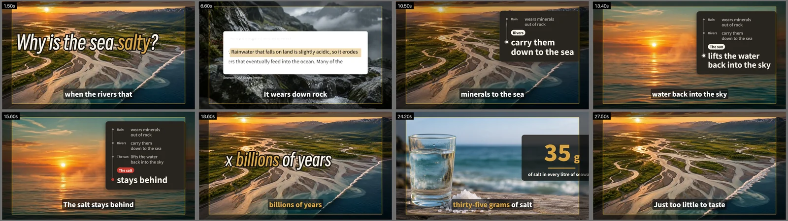
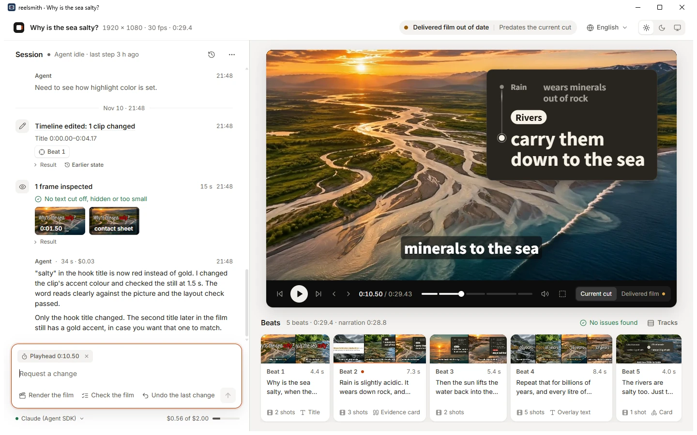

<h1 align="center">reelsmith</h1>

<p align="center">
  <b>A video editor your coding agent can drive.</b><br>
  Claude Code, Codex, Cursor or any MCP client edits a real timeline, looks at its own frames<br>
  and renders through checks that will not let a broken film out.
</p>

<p align="center">
  <a href="docs/media/sea.mp4"></a>
</p>

<p align="center"><sub>
  A coding agent made this film with reelsmith: it wrote and narrated the script, drew and animated the pictures,<br>
  captured the sentence that proves the claim, cut the timeline and rendered it.<br>
  <a href="docs/media/sea.mp4">Watch it with sound</a> · <a href="examples/sea">the project it wrote</a>
</sub></p>

A model can write a script and call a renderer, but it works blind: it does not see the title that runs off the
screen, the caption over a face or the cut that lands mid-word. reelsmith is an editing app built for it. The agent
builds the film clip by clip from footage, pictures, narration and React components, the way a person works in an
editor. reelsmith keeps every edit valid and undoable, times each clip to what it follows, measures where the words
land on the rendered frames, masters the loudness and holds the film to its delivery rules.

There is no pipeline and no template. Every tool can be called at any time, `project.json` can be edited by hand,
and the agent decides the story, the cut, the sound and the look.

## Visual verification

<p align="center">
  
</p>

This is what `preview` hands the agent: stills at the moments it asked for, the safe area outlined, and the layout
measured on those frames. In the seventh still it had pushed a card too far right, and was told so:

```text
layout: 1 problem(s), 1 would block render
[error] n1 @ 24.2s: text "of salt in every litre o" is cut by the canvas edge (right, 66 px): move it in or make it smaller
```

`render` measures the whole film the same way before it encodes, and refuses:

```text
NOT DELIVERED (stopped at layout): words sit where the viewer cannot read them (listed in layout): fix and render again
The previous out/film.mp4 is kept.
```

One `undo` later:

```text
DELIVERED: out/film.mp4 (29.43 s, 1920x1080 30 fps, h264/aac, -13.9 LUFS, 35.4 MB; rendered in 82.0 s). Look at it with review.
```

## Monitoring and conversational editing

<p align="center">
  
</p>

`reelsmith watch <project>` opens a desktop window on the film your agent is making. It is built for following an
agent rather than for editing by hand: a session lists each step the agent takes (the edit, the frames it inspected,
the result of each check, the cost of each paid call) beside the current cut, played with the film's own renderer, and
the film laid out as beats, one per narration line, each with its shots, cards and any issue found. A request such as
"make this title red", sent with a beat or an element selected, is carried out by the agent, verified on a rendered
frame and reported back in the session. The multi-track timeline is one key away, and a delivered film is
accepted in the same window. The interface is available in eight languages (English, Simplified and
Traditional Chinese, Japanese, Korean, Spanish, French, German), in light and dark themes. It runs on your machine
and talks to the engine you already have (Claude through the Agent SDK, Codex, DeepSeek Harness, or any
OpenAI-compatible API). [docs/watch.md](docs/watch.md) has the details.

```sh
pip install -e ".[app]"          # the desktop window (without it, a browser tab)
reelsmith watch ~/studio/projects/first
```

## Quick start

```sh
git clone https://github.com/wangkant/reelsmith && cd reelsmith
python -m venv .venv && source .venv/bin/activate     # Windows: .venv\Scripts\Activate.ps1
pip install -e ".[capture,web]"
cd renderer && npm ci && cd ..
```

Attach it to your coding agent, in the folder you run the agent in:

```sh
reelsmith setup claude-code      # or: codex, dsh, cursor, generic (--print shows what it would write)
```

Then ask: *"Cut my talk in ~/videos/talk.mp4 to its best 90 seconds, remove the pauses, add English captions and a
title card."* or *"Make a 60-second vertical explainer on why tea leaves curl."*

Needs Python 3.10+, Node.js 20+ and ffmpeg on `PATH`; `reelsmith doctor` checks all of it, and what each optional
tool needs. reelsmith reads its manual and renderer from the checkout, so keep the editable install.

## Let your coding agent set it up

Paste this into Claude Code, Codex, Cursor or any coding agent:

```text
Read https://raw.githubusercontent.com/wangkant/reelsmith/main/docs/setup-for-agents.md and set up reelsmith for me.
```

It asks where to install and before installing any system tool, checks the machine with `reelsmith doctor`,
attaches itself with `reelsmith setup <agent>` and renders a test film without a paid call.

## Capabilities

- **Edit a timeline.** Visual, audio and caption tracks; image, video, text, shape, evidence and component clips;
  keyframes with easing, Ken Burns moves, enter/exit presets, transitions, flips, filters and blend modes. Edits
  are atomic batches, validated and undoable.
- **Edit footage.** Probe a recording, look at stills at any source second, find shot cuts and silences, get a
  word-level transcript; cut with `"src:clip@12.4"` anchors, markers, ripple delete, insert gap and trim; reframe
  landscape footage for a vertical canvas with keyframed focus; speed curves, freeze frames and reverse; volume
  curves and ducking under the voice.
- **Captions and chapters.** Captions from the narration or from a transcript, following it through every cut,
  shown phrase by phrase or word by word, burned in and delivered as `.srt` and `.vtt`; chapters from markers.
- **Time to anything.** Times anchor on narration lines, clips, markers or source seconds (`"line:5+0.3"`,
  `"clip:c2.end-0.5"`, `"mark:intro"`, `"end-2"`): re-record the voice or recut a clip and the edit follows.
- **Look at its own work.** `describe` prints the editor's window as text; `preview` renders any moments in seconds
  with a contact sheet and measured layout problems; a draft render shows a stretch as video; `review` shows the
  delivered film a frame a second, with the line heard at each frame.
- **Make assets.** Narration (text-to-speech, cached per line), pictures (Codex image generation), evidence
  screenshots of web pages with the proving sentence boxed, short clips from a picture (image-to-video), and
  imports of local or downloaded media, animated GIFs included.
- **Any canvas, any language.** `landscape` (the default, 1920×1080), `vertical`, `square`, `portrait`, platform
  profiles (`youtube`, `shorts`, `tiktok`, `reels`, `douyin`, `douyin-long`, `bilibili`, `bilibili-story`,
  `xiaohongshu`, `channels`) and custom sizes and frame rates (NTSC included); a
  `locale` sets caption phrasing, the words components add, capture language and web requests; workspaces can add
  fonts.
- **Platform playbooks.** Each platform profile comes with a playbook the agent reads with the manual: how a film is
  made for YouTube and Shorts, Douyin, TikTok, Instagram Reels, Bilibili, Xiaohongshu and WeChat Channels (the
  frame, the first seconds, pace, words, sound, what to hand over, what gets a film limited), every number graded
  with its source.
- **Delivery checks.** Words outside the safe area, cut, tiny, overlapping or low in contrast (measured on rendered
  frames), loudness, black or frozen stretches, length, size and the workspace's own rules. A failed render keeps
  the previous film and says what to fix, with clip ids and times. Films of any length render.
- **Spend control.** Paid calls go through a ledger with a per-project budget and an account balance floor.

## Built-in scene components

<p align="center">
  
</p>

Fifteen React components are built in; twelve are shown above. Six are whole scenes for telling what happened (who
pays whom, what someone said, what a report found, two versions compared, events in order, winners and losers); the
rest are single moves: a receipt that prints, bars that grow, a number that counts up, a dated rule, a dot grid, a
stamp, an arrow, a highlighter, an evidence card. Each lands its parts at the times the agent gives and sizes
itself to its box, on any canvas.

The agent can also write its own. A component is a `.tsx` file and a JSON schema in the workspace's library, built
on a small documented kit ([docs/kit.md](docs/kit.md)), type-checked and import-guarded, and every project in the
workspace can use it afterwards.

## Coding agents

| agent | how |
|---|---|
| Claude Code | `reelsmith setup claude-code`, or the plugin: `/plugin marketplace add wangkant/reelsmith`, then `/plugin install reelsmith@reelsmith` |
| Codex | `reelsmith setup codex` |
| DeepSeek Harness | the plugin in [integrations/dsh](integrations/dsh) (a Video editor mode with a film, preview and timeline panel), or `reelsmith setup dsh` |
| Cursor | `reelsmith setup cursor` |
| any MCP client | `reelsmith setup generic`, or run the server yourself: `reelsmith mcp` (stdio) or `reelsmith mcp --http` |
| no client | `reelsmith run <project> --brief "..."`: an agent makes the film headless, on reelsmith's own loop over any OpenAI-compatible API, or on Codex, DeepSeek Harness or the Claude Agent SDK (`--engine`) |

Every agent gets the same tools and the reelsmith skill ([skills/reelsmith/SKILL.md](skills/reelsmith/SKILL.md)).
[docs/agents.md](docs/agents.md) covers each one, the HTTP transport and headless runs.

## Workspaces and projects

A workspace is a folder for one creator or channel; its projects share settings, rules, keys, a component library
and the agent's notes:

```
studio/
  workspace.json    profile, locale, theme, providers, budget, runner defaults (all optional)
  rules.json        hard rules (block delivery) and advice (information only)
  .env              provider keys; never shown to the agent
  library/          NOTES.md, the agent's components/, fonts/
  projects/<film>/  project.json, assets/, voice/, build/ (previews), out/ (film, subtitles, chapters)
```

[examples/workspace](examples/workspace) is a starter; [examples](examples) also has one channel's setup, to show
what a workspace can pin down, and the project of the film at the top of this page. Every agent tool is also a
command, for scripts and people (`reelsmith --help`):

```sh
P=~/studio/projects/first
reelsmith new $P --canvas 1920x1080@30 --locale en
reelsmith import $P talk ~/videos/talk.mp4      # bring in a recording (hard-linked when it can be)
reelsmith silences $P talk                     # silent ranges, in source seconds
reelsmith edit $P @ops.json                    # apply a batch of edit ops
reelsmith preview $P 0 mark:intro end-1        # stills + contact sheet + layout problems
reelsmith render $P                            # out/film.mp4, mastered and checked, with its subtitles
```

## Optional services

The editor, the previews, the checks and the render run on your machine and cost nothing. These tools need more:

| for | you need |
|---|---|
| `capture` (web page evidence) | the `capture` extra and Edge, Chrome or `python -m playwright install chromium` |
| `draw` (pictures) | the [Codex CLI](https://github.com/openai/codex), signed in |
| `speak` (narration) | an [OpenRouter](https://openrouter.ai) key (the default voice speaks English and Mandarin), or any OpenAI-compatible speech endpoint (`providers.tts.provider: "openai"`) |
| `animate` (image-to-video) | an OpenRouter key |
| `transcribe` | any OpenAI-compatible transcription endpoint (OpenAI, Groq, a local whisper server), or the `transcribe` extra (faster-whisper, on your machine) |
| `reelsmith run` | a model API key (OpenRouter by default; DeepSeek, OpenAI or a local server), or Codex or DeepSeek Harness installed; the `runner` extra for the Claude Agent SDK engine |

Paid calls estimate first and are refused over `budget.per_project_usd` (default $1) or under the account floor
`budget.min_balance_usd` (default $5); narration is cached per line, so only changed lines are paid for again. The
film at the top of this page cost $0.53: five animated clips and five lines of narration.

## Documentation

- [docs/manual.md](docs/manual.md): the agent's manual (what the `manual` tool returns).
- [docs/platforms/](docs/platforms/): the platform playbooks; `reelsmith manual <project>` prints the manual followed
  by the playbook of the project's profile.
- [docs/editor-spec.md](docs/editor-spec.md): the full reference: layout, settings and defaults, the project format,
  edit ops, providers, checks, profiles, the renderer's input and the runner.
- [docs/agents.md](docs/agents.md): attaching coding agents and running them headless.
- [docs/kit.md](docs/kit.md): `@reelsmith/kit`, for writing components.

## Development

```sh
pip install -e ".[dev]" && pytest
cd renderer && npm run typecheck && node test/selftest.mjs && cd ..
cd integrations/dsh && npm ci && npm test && cd ../..
python integrations/sync_skills.py --check     # the plugin's copy of the skill
```

## License

reelsmith is source-available under the [PolyForm Noncommercial License 1.0.0](LICENSE): it may be used, modified
and shared for noncommercial purposes. Commercial use requires a separate license from the author; open an issue
to enquire. Releases published before 10 November 2026 were made under the MIT license.

The renderer depends on [Remotion](https://www.remotion.dev), which has its own license: free for individuals and
small teams; larger companies need a Remotion company license (https://www.remotion.dev/license). The bundled
Smiley Sans font is under the SIL Open Font License
([renderer/src/fonts/SmileySans-OFL.txt](renderer/src/fonts/SmileySans-OFL.txt)).
